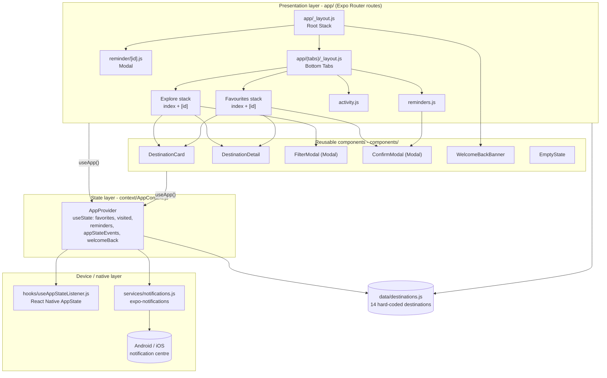
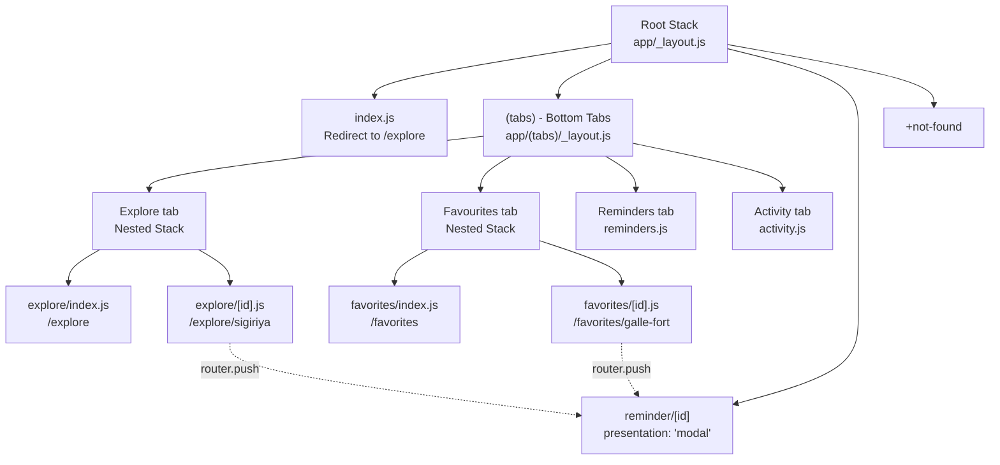
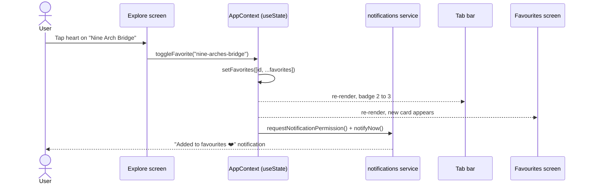
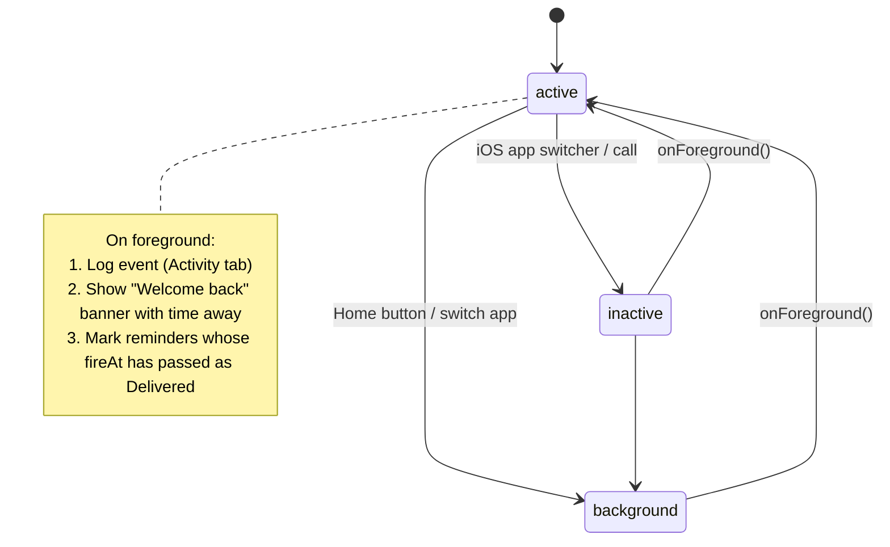
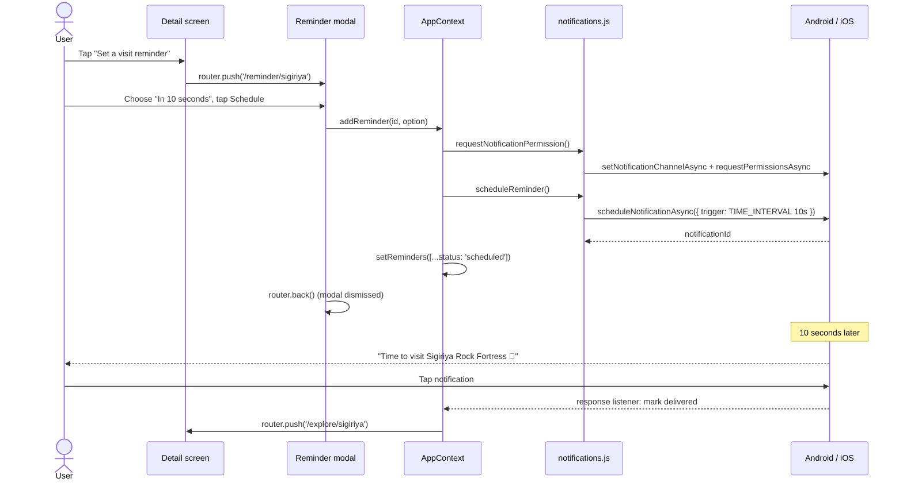

# 🌴 Lanka Trails – Sri Lanka Travel Companion

| | |
|---|---|
| **Student Name** | H.B.P Janani Ayeshika |
| **Student ID** | MSc/CS/2025/014 |
| **Course** | COSC 64173 – Mobile Computing |
| **Assignment** | Assignment 01 – Multi-screen React Native app with Expo Router |
| **Institution** | Department of Statistics & Computer Science, University of Kelaniya |
| **🎥 Demonstration video** | **[Watch the demo on YouTube / Google Drive](<PASTE-YOUR-PUBLIC-VIDEO-LINK-HERE>)** |
| **📦 Repository** | https://github.com/jananiayeshika/mobile-computing-assignment1 |

> **Lanka Trails** is a cross-platform mobile app (Android & iOS) built with **React Native**, **Expo SDK 58** and **Expo Router**, written in **JavaScript**. It helps travellers discover, shortlist and plan visits to 14 of Sri Lanka's best-known destinations: Sigiriya, the Temple of the Tooth, Galle Fort, Yala, Ella's Nine Arch Bridge and more.

---

## 📑 Table of Contents

1. [What is the application and what problem does it solve?](#1-what-is-the-application-and-what-problem-does-it-solve)
2. [Key features](#2-key-features)
3. [Screens: how many and what each one does](#3-screens-how-many-and-what-each-one-does)
4. [Tools and technologies](#4-tools-and-technologies)
5. [Architecture](#5-architecture)
6. [Expo Router structure (`app/` directory)](#6-expo-router-structure-app-directory)
7. [Core React Native components used and where](#7-core-react-native-components-used-and-where)
8. [Global state management](#8-global-state-management)
9. [AppState: background to foreground detection](#9-appstate-background-to-foreground-detection)
10. [Local notifications: research and implementation](#10-local-notifications-research-and-implementation)
11. [Hard-coded data](#11-hard-coded-data)
12. [Setup: clone, install and run](#12-setup-clone-install-and-run)
13. [How to use the app (demo walkthrough)](#13-how-to-use-the-app-demo-walkthrough)
14. [Assignment requirements checklist](#14-assignment-requirements-checklist)
15. [Troubleshooting](#15-troubleshooting)
16. [Image credits and license](#16-image-credits-and-license)

---

## 1. What is the application and what problem does it solve?

**Lanka Trails** is a pocket travel guide and trip planner for Sri Lanka.

### The problem

People planning a trip around Sri Lanka, whether they are foreign tourists or locals on a weekend getaway, usually run into the same issues:

- **Scattered information.** Ticket prices (which differ for foreigners and Sri Lankans), opening hours, the best season to visit and practical tips are spread across many websites, blogs and social media posts.
- **Seasonality is easy to miss.** Yala Block I closes in September and October, Adam's Peak is only climbed from December to May, the whale season in Mirissa runs from November to April, and the Arugam Bay surf season runs from April to October.
- **Forgetting plans.** Travellers save places in screenshots or notes, then forget to actually go, or miss the early-morning start that places like Horton Plains and Sigiriya need.

### The solution

Lanka Trails puts everything in one offline-friendly app:

| Need | How Lanka Trails helps |
|---|---|
| "What is worth visiting?" | A searchable, filterable list of 14 curated destinations with photos, ratings and categories |
| "How much, when and how long?" | Each destination shows foreign and local entry fees, opening hours, best season, recommended duration, distance from Colombo and GPS coordinates |
| "I want to remember this place." | One tap adds it to **Favourites**, which are shared across all screens and shown as a tab badge |
| "Remind me to go." | Schedule a **local notification** reminder: in 10 seconds (for the demo), 1 minute, 1 hour or tomorrow at 7:00 AM |
| "Did I miss anything while I was away?" | The app uses the **AppState API** to detect when you return. It shows a *Welcome back* banner and marks reminders that fired while you were away as delivered |

---

## 2. Key features

- 🧭 **Explore** 14 real Sri Lankan destinations in a `FlatList` with live search
- 🎛️ **Filter and sort `Modal`** (category, free entry only, UNESCO only, sort by rating, name, distance or price)
- 📄 **Detail screen** with a hero image, stats, UNESCO badge, visiting info, highlights and travel tips
- ❤️ **Favourites** shared globally, with a tab badge counter and a **confirmation `Modal`** before removing
- ✅ **Mark as visited**, shared across screens
- ⏰ **Visit reminders**, a modal route that schedules **local notifications** (time-interval and date triggers)
- 🔔 **Immediate notification** when a destination is added to favourites ("Added to favourites ❤️")
- 👆 **Tapping a notification** deep-links to that destination's detail screen
- 🔄 **AppState listener** that shows a "Welcome back, you were away for X" banner, keeps an event log and reconciles reminders
- 📊 **Activity screen** showing the live AppState value, the event log, notification permission status and a test-notification button

---

## 3. Screens: how many and what each one does

The app has **7 unique screens** (6 feature screens plus a "not found" fallback). The destination detail screen is reused in two tab stacks.

| # | Screen | Route (URL) | File | Purpose |
|---|---|---|---|---|
| 1 | **Explore** (home) | `/explore` | `app/(tabs)/explore/index.js` | Lists all destinations in a `FlatList`, with a search bar, a filter/sort `Modal` and a heart toggle on each card. |
| 2 | **Destination detail** | `/explore/[id]` and `/favorites/[id]` | `app/(tabs)/explore/[id].js`, `app/(tabs)/favorites/[id].js` → `components/DestinationDetail.js` | Full information about one place: image, rating, fees, opening hours, best time, duration, coordinates, highlights and tips. Buttons to **Save**, **Mark visited** and **Set a visit reminder**. |
| 3 | **Favourites** | `/favorites` | `app/(tabs)/favorites/index.js` | Shows the destinations saved in **global state**, with the total estimated ticket cost. Removing one opens a **confirmation `Modal`**. |
| 4 | **Reminders** | `/reminders` | `app/(tabs)/reminders.js` | Lists every scheduled notification with its status (Scheduled, Delivered or Cancelled). Cancelling asks for confirmation and cancels the OS notification. |
| 5 | **Activity** | `/activity` | `app/(tabs)/activity.js` | Shows the current **AppState** value, a log of background/foreground events, statistics from shared state, the notification permission status and a "send test notification" button. |
| 6 | **Set reminder** (modal) | `/reminder/[id]` | `app/reminder/[id].js` | A screen **presented as a modal** by the root stack. You choose when to be reminded and schedule a local notification. It is dismissed with *Cancel*, the swipe-down gesture or the Android back button. |
| 7 | **Not found** | any unknown URL | `app/+not-found.js` | Fallback screen with a button back to Explore. |

`app/index.js` is not a visible screen. It redirects `/` to `/explore`.

---

## 4. Tools and technologies

| Category | Technology | Version | Why it is used |
|---|---|---|---|
| Language | **JavaScript (ES2022 + JSX)** | – | Required by the assignment (no TypeScript) |
| Framework | **React Native** | 0.88.1 | Cross-platform native UI |
| UI library | **React** | 19.3.0 | Components, hooks and Context |
| Platform / SDK | **Expo** | SDK 58 (`expo ~58.0.23`) | Tooling, Expo Go, native modules without Xcode or Android Studio |
| Navigation | **Expo Router** | ~58.0.30 | File-based routing: Stack, Tabs and modal presentation |
| Notifications | **expo-notifications** | ~58.1.8 | Scheduling, presenting and responding to **local** notifications |
| Native API | **AppState** (from `react-native`) | built-in | Detects foreground and background transitions |
| Icons | **@expo/vector-icons** (Ionicons) | ^15.0.2 | Tab bar and UI icons |
| Fonts | **expo-font** | ~58 | Required peer dependency of vector icons |
| Navigation peers | react-native-screens, react-native-safe-area-context, expo-linking, expo-constants | SDK-matched | Required by Expo Router |
| Status bar | **expo-status-bar** | ~58.0.4 | Light status bar on the teal header |
| Web (optional) | react-native-web, react-dom | 0.21 / 19.3 | Lets the UI run in a browser (notifications are not supported on web) |
| Linting | **ESLint** with `eslint-config-expo` | 9.x | Run with `npm run lint` |
| Diagnostics | **expo-doctor** | latest | Checks the project (20/20 checks pass) |
| Testing device | **Expo Go** app (Android / iOS) | SDK 58 | Runs the project on a real phone by scanning a QR code |
| Editor | Visual Studio Code | – | Development |
| Version control | Git and GitHub | – | Source control and submission |

---

## 5. Architecture

### 5.1 High-level architecture

The app follows a layered structure. **Routes** (screens) only render UI and call into **shared state**. Shared state uses **services** and **hooks** to talk to native device APIs. **Data** is a static JavaScript module.



### 5.2 Project folder structure

```text
mobile-computing-assignment1/
├── app/                          # Expo Router: every file is a route
│   ├── _layout.js                # Root Stack + AppProvider + notification listeners + banner
│   ├── index.js                  # "/" -> redirects to /explore
│   ├── +not-found.js             # Unknown routes
│   ├── reminder/
│   │   └── [id].js               # "Set reminder" screen (presentation: 'modal')
│   └── (tabs)/                   # Route group: does not appear in the URL
│       ├── _layout.js            # Bottom Tabs navigator
│       ├── explore/              # Tab 1 with a NESTED STACK
│       │   ├── _layout.js        #   Stack navigator
│       │   ├── index.js          #   /explore       destination list
│       │   └── [id].js           #   /explore/:id   destination detail
│       ├── favorites/            # Tab 2 with a NESTED STACK
│       │   ├── _layout.js        #   Stack navigator
│       │   ├── index.js          #   /favorites     saved list
│       │   └── [id].js           #   /favorites/:id destination detail
│       ├── reminders.js          # Tab 3: /reminders
│       └── activity.js           # Tab 4: /activity
├── components/                   # Reusable UI (not routes)
│   ├── DestinationCard.js        # FlatList row (Pressable, Image, Text, View)
│   ├── DestinationDetail.js      # Shared detail UI used by both [id] routes
│   ├── FilterModal.js            # <Modal> for filtering and sorting
│   ├── ConfirmModal.js           # <Modal> for confirming destructive actions
│   ├── WelcomeBackBanner.js      # Animated banner driven by AppState
│   └── EmptyState.js             # Placeholder for empty lists
├── context/
│   └── AppContext.js             # Global state (Context + useState)
├── hooks/
│   └── useAppStateListener.js    # AppState background -> foreground detection
├── services/
│   └── notifications.js          # All expo-notifications logic
├── data/
│   └── destinations.js           # Hard-coded realistic data
├── constants/
│   └── theme.js                  # Colours, spacing, radius, shadow tokens
├── utils/
│   └── format.js                 # Duration, date and number formatters
├── assets/
│   └── images/                   # 14 destination photos (bundled locally)
├── app.json                      # Expo config (scheme, plugins, notification colour)
├── package.json                  # Dependencies and npm scripts
└── eslint.config.js              # ESLint (eslint-config-expo)
```

**Design decisions**

- **Only routes live in `app/`.** Components, state, hooks and services sit in their own folders so Expo Router doesn't treat them as screens.
- **Images are bundled locally** (`require('../assets/images/…')`) rather than loaded from URLs. The app works offline, loads instantly and avoids hot-link blocking by image hosts.
- **The notification service is isolated.** Screens never import `expo-notifications` directly (except the root listeners), which keeps the screens simple and the native code in one place.

---

## 6. Expo Router structure (`app/` directory)

Expo Router turns the **file system into the navigation tree**:

| File-name convention | Meaning in this project |
|---|---|
| `_layout.js` | Defines a navigator (Stack or Tabs) for its folder |
| `index.js` | The default route of a folder (`/explore`, `/favorites`) |
| `[id].js` | A **dynamic route**. `id` is read with `useLocalSearchParams()` |
| `(tabs)/` | A **route group**. Organises files without adding `/tabs` to the URL |
| `+not-found.js` | Catch-all for unmatched URLs |

### 6.1 Navigation tree



### 6.2 The three navigators

1. **Root Stack** (`app/_layout.js`). Contains the whole tab navigator plus the **modal** route `reminder/[id]` (`presentation: 'modal'`). The modal slides up over the tabs and can be dismissed by swiping down (iOS), pressing the hardware back button (Android), tapping *Cancel*, or automatically after a reminder is scheduled (`router.back()`).
2. **Bottom Tabs** (`app/(tabs)/_layout.js`). Four tabs: Explore, Favourites, Reminders and Activity. The Favourites and Reminders tabs show **badges** that are calculated from global state.
3. **Nested Stacks** (`app/(tabs)/explore/_layout.js` and `app/(tabs)/favorites/_layout.js`). Each tab has its **own history**. Opening a destination from Favourites pushes `/favorites/[id]`, so the header **back arrow returns to Favourites** and not to Explore. Opening from Explore returns to Explore.

### 6.3 How navigation is triggered in code

```js
// List -> detail (push onto the tab's nested stack)
router.push({ pathname: '/explore/[id]', params: { id: item.id } });

// Detail -> modal (push onto the ROOT stack, presented as a modal)
router.push({ pathname: '/reminder/[id]', params: { id: destination.id } });

// Dismiss the modal after scheduling, or when Cancel is pressed
router.back();

// Read the dynamic segment
const { id } = useLocalSearchParams();

// Set the stack header title and heart button from inside a screen
<Stack.Screen options={{ title: destination.name, headerRight: () => <HeartButton /> }} />
```

### 6.4 Back and dismiss behaviour

| From | Action | Result |
|---|---|---|
| `/explore/sigiriya` | Header back arrow / Android back / iOS swipe | Returns to `/explore` |
| `/favorites/galle-fort` | Header back arrow / Android back | Returns to `/favorites` (stays in the Favourites tab) |
| `/reminder/sigiriya` (modal) | *Cancel*, swipe down, Android back, or after *Schedule* | Modal is dismissed and the detail screen is visible again |
| Filter `Modal` | Tap the backdrop, the ✕ button, Android back (`onRequestClose`) or *Show results* | Modal closes |
| Confirm `Modal` | *Cancel* / Android back | Modal closes without any change |

---

## 7. Core React Native components used and where

| Component | Where it is used | What for |
|---|---|---|
| **`View`** | Every screen and component | Layout containers, cards, rows |
| **`Text`** | Every screen and component | All labels, titles and descriptions |
| **`Image`** | `components/DestinationCard.js`, `components/DestinationDetail.js`, `app/(tabs)/reminders.js`, `app/reminder/[id].js` | Destination photos (hero, card and thumbnail) |
| **`Pressable`** | `DestinationCard` (open card, heart), `DestinationDetail` (Save, Visited, Set reminder, header heart), `FilterModal` (chips, radio rows, buttons), `ConfirmModal`, `EmptyState`, Explore (filter button), Favourites (Remove), Reminders (card, cancel), Activity (test notification), Reminder modal (options, Cancel, Schedule) | Every tappable element, with a `pressed` visual state |
| **`FlatList`** | `app/(tabs)/explore/index.js` (all destinations), `app/(tabs)/favorites/index.js` (saved destinations), `app/(tabs)/reminders.js` (reminders), `app/(tabs)/activity.js` (AppState event log) | Efficient virtualised lists of hard-coded or state data, using `ListHeaderComponent` and `ListEmptyComponent` |
| **`Modal`** | `components/FilterModal.js` (**filtering data**, a bottom-sheet with `animationType="slide"`), `components/ConfirmModal.js` (**confirming user actions**: removing a favourite, cancelling a reminder) | Both modal use cases from the brief |
| `ScrollView` | `DestinationDetail.js`, `FilterModal.js` | Long scrolling content |
| `TextInput` | `app/(tabs)/explore/index.js` | Live search |
| `Switch` | `FilterModal.js` | "Free entry only" and "UNESCO only" toggles |
| `ActivityIndicator` | `app/reminder/[id].js` | Spinner while a notification is being scheduled |
| `Animated` | `components/WelcomeBackBanner.js` | Fading the AppState banner in and out |
| `Alert` | `app/reminder/[id].js`, `app/(tabs)/activity.js` | Success and error messages |
| `StyleSheet` | All files | Styles |
| `AppState` | `hooks/useAppStateListener.js` | Foreground and background detection |

Expo Router components used: `Stack`, `Tabs`, `Redirect`, `Stack.Screen`, `useRouter`, `useLocalSearchParams`.

---

## 8. Global state management

State is managed with **React Context + `useState`** (as allowed by the brief) in `context/AppContext.js`. `<AppProvider>` wraps the entire app in the root layout, so **every screen reads and writes the same data** through the `useApp()` hook.

| State | Type | Updated by | Read by |
|---|---|---|---|
| `favorites` | `string[]` (destination ids) | Heart on Explore cards, heart and *Save* on Detail, *Remove* on Favourites | Explore (heart icons, summary), Detail, Favourites list, **tab badge**, Activity stats |
| `visited` | `string[]` | *Mark visited* on Detail | Detail, Favourites ("Visited" tag), Explore summary, Activity stats |
| `reminders` | `{ id, destinationId, destinationName, label, fireAt, status }[]` | Reminder modal (add), Reminders tab (cancel or clear), notification listener and AppState (mark delivered) | Reminders list, **tab badge**, Detail ("2 active"), Activity stats |
| `appStateEvents` | `{ type, from/to, at, awayMs }[]` | AppState listener | Activity log and stats |
| `welcomeBack` | object or `null` | AppState listener | `WelcomeBackBanner` |
| `permission` | `'granted' \| 'denied' \| 'undetermined' \| 'unsupported'` | Any notification request | Activity screen |



The app starts with **Sigiriya** and **Galle Fort** already in favourites and the **Temple of the Tooth** marked as visited, so the shared state is visible straight away during the demo.

---

## 9. AppState: background to foreground detection

**Docs used:** React Native AppState API and the Expo documentation on AppState.

`AppState.currentState` can be `active` (foreground), `background`, or `inactive` (iOS only, during transitions such as opening the app switcher).

### 9.1 Implementation (`hooks/useAppStateListener.js`)

```js
const appState = useRef(AppState.currentState);

useEffect(() => {
  const subscription = AppState.addEventListener('change', (nextAppState) => {
    // active -> background: remember when the user left
    if (appState.current === 'active' && /inactive|background/.test(nextAppState)) {
      backgroundedAt.current = Date.now();
      onBackground?.(...);
    }
    // background -> active: THE APP CAME BACK TO THE FOREGROUND
    if (/inactive|background/.test(appState.current) && nextAppState === 'active') {
      const awayMs = Date.now() - backgroundedAt.current;
      onForeground?.({ from: appState.current, awayMs });
    }
    appState.current = nextAppState;
  });
  return () => subscription.remove(); // cleanup on unmount
}, []);
```

### 9.2 What happens when the app returns to the foreground



1. A **"Ayubowan, welcome back! 👋 You were away for 1m 12s · 1 reminder delivered"** banner slides in over any screen for 5 seconds (`components/WelcomeBackBanner.js`).
2. The event is added to the **AppState event log** on the Activity tab, which also shows the live `currentAppState`.
3. **Reminders reconciliation**: any reminder whose fire time passed while the app was in the background is changed from *Scheduled* to *Delivered* in the Reminders tab.

The listener is registered **once** in `AppProvider`, using refs to hold the latest callbacks. This avoids duplicate subscriptions and is cleaned up with `subscription.remove()`.

---

## 10. Local notifications: research and implementation

### 10.1 How I researched it

1. **Read the official Expo docs for the installed SDK version.** I checked `package.json` (Expo **SDK 58**) and followed the versioned docs for `expo-notifications`, because the API changes between SDKs. For example, `shouldShowAlert` is now **deprecated** in favour of `shouldShowBanner` and `shouldShowList`, and triggers now need an explicit `type` such as `SchedulableTriggerInputTypes.TIME_INTERVAL`.
2. **Checked Expo Go limitations.** Since SDK 53, **remote push** notifications on Android no longer work in Expo Go, but **local notifications still work**. That is why this project uses only local notifications and sets `enableRemoteNotifications: false` in the config plugin, so no push tokens, Firebase or APNs set-up are needed.
3. **Learned the platform rules:**
   - **Android 8+** needs a **notification channel**. On **Android 13+** the channel must be created **before** asking for permission, otherwise the system prompt does not appear.
   - **iOS** can grant *provisional* permission, which should also count as allowed.
   - Notifications received while the app is **open** are hidden unless `setNotificationHandler` is configured.
4. **Read the TypeScript definitions in `node_modules/expo-notifications`** to confirm the exact trigger shapes (`TimeIntervalTriggerInput`, `DateTriggerInput`, `ChannelAwareTriggerInput`) and the newer synchronous `getLastNotificationResponse()` API.
5. **Designed for testing on a real device** with Expo Go. That's why there is a **10-second** reminder option: you can schedule it, lock the phone or go to the home screen, see it arrive, then tap it to open the destination.

### 10.2 How it is implemented

All the logic lives in **`services/notifications.js`**:

| Function | What it does |
|---|---|
| `configureNotificationHandler()` | Calls `Notifications.setNotificationHandler` (at module level in the root layout) so notifications also show as a banner while the app is open |
| `requestNotificationPermission()` | Creates the Android channel `visit-reminders` (HIGH importance), then `getPermissionsAsync()`, and only calls `requestPermissionsAsync()` if needed |
| `notifyNow({ title, body, data })` | **Immediate** notification (`trigger: null`, or `{ channelId }` on Android). Used for "Added to favourites ❤️" and the Activity test button |
| `scheduleReminder({ destination, option })` | **Scheduled** notification. Uses a `TIME_INTERVAL` trigger (10 s, 60 s, 3600 s) or a `DATE` trigger (tomorrow 07:00). Returns the identifier and fire time |
| `cancelReminder(id)` | `cancelScheduledNotificationAsync(id)` |

In **`app/_layout.js`** (`NotificationObserver`):

- `addNotificationReceivedListener` marks the reminder **Delivered** if it arrives while the app is open.
- `addNotificationResponseReceivedListener` runs when the user **taps** a notification and calls `router.push('/explore/[id]')` to open that destination.
- `getLastNotificationResponse()` handles the case where the app was **launched** by tapping a notification.



### 10.3 Notification content examples

| Trigger | Title | Body |
|---|---|---|
| Immediate (favourite) | `Added to favourites ❤️` | `Nine Arch Bridge was saved to your trip wishlist.` |
| Scheduled reminder | `Time to visit Sigiriya Rock Fortress 🌴` | `The 5th-century "Lion Rock" citadel. Opening hours: 07:00 – 17:30 (last entry 17:00).` |
| Test (Activity tab) | `Lanka Trails 🌴` | `Notifications are working! …` |

---

## 11. Hard-coded data

All content is in **`data/destinations.js`**: 14 destinations with realistic values (2025/2026 indicative ticket prices, real opening hours, seasons, distances and GPS coordinates).

| Destination | Category | District | Foreign entry | Hours | Best time | Rating |
|---|---|---|---|---|---|---|
| Sigiriya Rock Fortress | Heritage | Matale | USD 35 | 07:00 – 17:30 | Jan – Apr | 4.8 |
| Temple of the Sacred Tooth Relic | Religious | Kandy | LKR 2,000 | 05:30 – 20:00 | Jul/Aug (Perahera) | 4.7 |
| Galle Fort | Heritage | Galle | Free | 24 hours | Dec – Apr | 4.7 |
| Nine Arch Bridge | Nature | Badulla | Free | 24 hours | Jan – Mar | 4.6 |
| Yala National Park | Wildlife | Hambantota | USD 25 + jeep | 06:00 – 18:00 | Feb – Jul | 4.6 |
| Horton Plains & World's End | Nature | Nuwara Eliya | USD 25 | 06:00 – 18:00 | Jan – Mar | 4.7 |
| Dambulla Cave Temple | Religious | Matale | LKR 2,000 | 07:00 – 19:00 | All year | 4.6 |
| Mirissa Beach | Beach | Matara | Free | 24 hours | Nov – Apr | 4.5 |
| Adam's Peak (Sri Pada) | Nature | Ratnapura | Free | Dec – May season | Jan – Mar | 4.8 |
| Sacred City of Anuradhapura | Heritage | Anuradhapura | USD 25 | 07:00 – 18:00 | Jun / Dec – Mar | 4.7 |
| Ancient City of Polonnaruwa | Heritage | Polonnaruwa | USD 25 | 07:30 – 18:00 | Dec – Apr | 4.7 |
| Pinnawala Elephant Orphanage | Wildlife | Kegalle | LKR 3,000 | 08:30 – 18:00 | All year | 4.3 |
| Arugam Bay | Beach | Ampara | Free | 24 hours | Apr – Oct | 4.6 |
| Unawatuna Beach | Beach | Galle | Free | 24 hours | Nov – Apr | 4.4 |

Each record also includes: `tagline`, `province`, `reviews`, the local (Sri Lankan) fee, `visitDuration`, `distanceFromColombo`, `coordinates`, UNESCO status, a full `description`, a list of `highlights` and practical `tips`.

> ℹ️ Ticket prices in Sri Lanka change often. Treat the values as indicative.

---

## 12. Setup: clone, install and run

### 12.1 Prerequisites

| Tool | Version | Check |
|---|---|---|
| [Node.js](https://nodejs.org/) | **20 LTS or newer** | `node -v` |
| npm | 10+ (comes with Node) | `npm -v` |
| Git | any recent | `git --version` |
| **Expo Go** app on your phone | the version that supports **SDK 58** | [Android – Play Store](https://play.google.com/store/apps/details?id=host.exp.exponent) · [iOS – App Store](https://apps.apple.com/app/expo-go/id982107779) |
| *(optional)* Android Studio emulator / Xcode iOS simulator | – | To run without a physical phone |

> 📱 **Use a physical phone for the notification demo.** Notifications are most reliable on a real device. Simulators and emulators can be limited, and the web build does not support notifications.

### 12.2 Clone and install

```bash
# 1. Clone the repository
git clone https://github.com/jananiayeshika/mobile-computing-assignment1.git

# 2. Go into the project folder
cd mobile-computing-assignment1

# 3. Install dependencies
npm install
```

### 12.3 Run the app

```bash
# Start the Expo development server (Metro bundler)
npx expo start
```

Then:

| Target | How |
|---|---|
| **Android phone** | Open **Expo Go** and scan the QR code shown in the terminal |
| **iPhone** | Scan the QR code with the **Camera** app, then open it in Expo Go |
| **Android emulator** | Press **`a`** in the terminal (or run `npm run android`) |
| **iOS simulator** (macOS) | Press **`i`** in the terminal (or run `npm run ios`) |
| **Web browser** (UI only, no notifications) | Press **`w`** (or run `npm run web`) |

If your phone and computer are on **different networks**, or the QR code won't connect, use a tunnel:

```bash
npx expo start --tunnel
```

### 12.4 Useful scripts

| Command | Description |
|---|---|
| `npm start` | `expo start`: start the dev server |
| `npm run android` | Start and open on Android |
| `npm run ios` | Start and open on iOS |
| `npm run web` | Start and open in a browser |
| `npm run lint` | Run ESLint (`expo lint`) |
| `npx expo start --clear` | Start with a cleared Metro cache |
| `npx expo-doctor` | Check the project configuration and dependency versions |

---

## 13. How to use the app (demo walkthrough)

This is also the script followed in the demonstration video.

1. **Explore the data.** The app opens on **Explore** and shows 14 destinations with photos, category badges, district, distance from Colombo and ratings (for example *Sigiriya Rock Fortress · Matale · 175 km · ★ 4.8*).
2. **Search and filter.** Type `Galle` in the search bar. Tap the **filter icon** to open the **filter `Modal`**, choose **Beach** and **Sort by: Nearest to Colombo**, then tap **Show results**.
3. **Open a detail screen.** Tap **Sigiriya Rock Fortress** to see the USD 35 fee, 07:00 – 17:30 hours, UNESCO 1982 badge, highlights and tips. Tap the **back arrow** to return.
4. **State management.** Tap ❤️ on **Nine Arch Bridge**. An **"Added to favourites ❤️"** notification appears, and the **Favourites tab badge** goes from 2 to 3. Open the **Favourites** tab and the bridge is there. Open it, then press back, and you return to Favourites.
5. **Confirmation modal.** On Favourites, tap **Remove** on Galle Fort. The **confirm `Modal`** asks first. Confirm, and the badge decreases.
6. **Schedule a notification.** Open a destination, tap **Set a visit reminder**, and the **modal screen** slides up. Choose **In 10 seconds** and tap **Schedule**. The modal dismisses. The Reminders tab now shows a badge and a *Scheduled* item.
7. **AppState and notification together.** Press the **Home button** right away. After about 10 s the reminder notification appears on the lock or home screen. Re-open the app and the **"Welcome back, you were away for 14s · 1 reminder delivered"** banner appears. The Reminders tab now shows **Delivered**, and the **Activity** tab logs `active → background` and `background → active`.
8. **Tap a notification.** Schedule another reminder, background the app and tap the notification when it arrives. The app opens directly on that destination's detail screen.
9. **Activity tab.** Shows the live AppState, the event log, statistics and a **Send a test notification now** button.

---

## 14. Assignment requirements checklist

| Area | Requirement | Where it is implemented | Status |
|---|---|---|---|
| **Components** | View, Text, Image, Pressable | All screens; see [section 7](#7-core-react-native-components-used-and-where) | ✅ |
| | Hard-coded data in a **FlatList** | `data/destinations.js` → `app/(tabs)/explore/index.js` (plus Favourites, Reminders, Activity) | ✅ |
| | **Modal** for filtering or confirming | `components/FilterModal.js` (filtering) **and** `components/ConfirmModal.js` (confirming) | ✅ |
| **Navigation** | File-based routing with Expo Router | `app/` directory | ✅ |
| | Tab navigation layout | `app/(tabs)/_layout.js` | ✅ |
| | Nested stack layout | `app/(tabs)/explore/_layout.js`, `app/(tabs)/favorites/_layout.js` | ✅ |
| | Back and dismiss work correctly | Stack back buttons, modal `router.back()`, `onRequestClose` | ✅ |
| **State** | Interactive data shared across screens (`useState`) | `context/AppContext.js` → favourites, visited, reminders | ✅ |
| **AppState** | Listener detecting background → foreground | `hooks/useAppStateListener.js`, `WelcomeBackBanner.js`, `activity.js` | ✅ |
| **Notification** | Immediate **and** scheduled local notifications | `services/notifications.js`, `app/reminder/[id].js`, `context/AppContext.js` | ✅ |
| **Deliverables** | JavaScript project from the standard Expo template | `create-expo-app --template blank` (JavaScript) + Expo Router | ✅ |
| | Clean, organised folders | See [5.2](#52-project-folder-structure); ESLint passes | ✅ |
| | Realistic hard-coded data | [Section 11](#11-hard-coded-data) | ✅ |
| | Detailed README | This file | ✅ |
| | Demo video link | At the top of this README | ⬜ add your link |
| | Name and student ID at the top | At the top of this README | ✅ |

---

## 15. Troubleshooting

| Problem | Fix |
|---|---|
| **No notification appears** | Make sure notifications are allowed: *Settings → Apps → Expo Go → Notifications*. Use a physical device. Check the permission on the **Activity** tab. |
| Notification only appears in the tray, not as a pop-up (Android) | Long-press the notification → *Settings* → set the **Visit reminders** channel to *Pop on screen*. |
| "Tomorrow at 7:00 AM" arrives a few minutes late on Android 12+ | Android batches inexact alarms. Exact timing needs the `SCHEDULE_EXACT_ALARM` permission (needs a development build). The 10-second and 1-minute options are best for the demo. |
| Expo Go says the project is incompatible | Update Expo Go to the version that supports **SDK 58**. |
| Phone can't connect to Metro | Put the phone and computer on the same Wi-Fi, or run `npx expo start --tunnel`. |
| Strange bundling errors after changing files | `npx expo start --clear` |
| "Not supported" on web | Expected. `expo-notifications` has no web implementation, but the rest of the UI works in the browser. |

---

## 16. Image credits and license

Destination photos come from **Wikimedia Commons**. They were resized to 960 px and bundled in `assets/images/` under their original licenses:

| File | Author | License |
|---|---|---|
| `sigiriya.jpg` | Wrobell | CC BY-SA 3.0 |
| `temple-of-the-tooth.jpg` | A.Savin | Free Art License |
| `galle-fort.jpg` | Rovin Shanila | CC BY-SA 4.0 |
| `nine-arches-bridge.jpg` | Deitel55 | CC BY-SA 3.0 |
| `yala.jpg` | Ranmith Welikala | CC BY-SA 4.0 |
| `horton-plains.jpg` | Faslan (en.wikipedia) | CC BY-SA 3.0 |
| `dambulla.jpg` | Lankapic | CC BY 2.5 |
| `mirissa.jpg` | Ji-Elle | CC BY-SA 3.0 |
| `adams-peak.jpg` | Bourgeois | CC BY-SA 3.0 |
| `anuradhapura.jpg` | Thisaru Tharuka | CC BY-SA 4.0 |
| `polonnaruwa.jpg` | Bernard Gagnon | CC BY-SA 3.0 |
| `pinnawala.jpg` | Bernard Gagnon | CC BY-SA 3.0 |
| `arugam-bay.jpg` | Dennis Sylvester Hurd | CC0 |
| `unawatuna.jpg` | Bernard Gagnon | CC BY-SA 3.0 |

The source code is released under the MIT License (see `LICENSE`). This project was created for academic purposes for COSC 64173 – Mobile Computing, University of Kelaniya.
